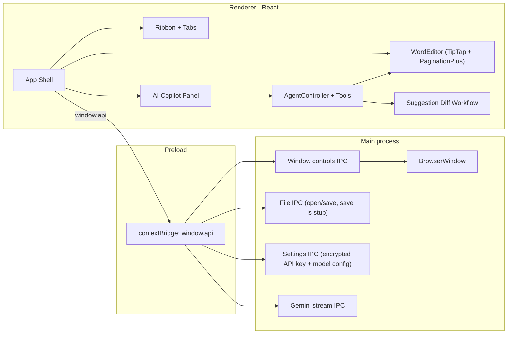

# WordClone - Agentic Document Editor

WordClone is a desktop document editor that combines the best parts of **MS Word** (layout precision, page formatting, rich editing) and **Cursor** (agentic assistance, context-aware editing, tool-driven actions).

The target is a production-ready, real-world app where an AI agent can control the full document lifecycle: text, style, layout, pagination, margins, page breaks, page numbering, and research-assisted writing.

## Product Vision (Cursor + Word)

### End goal

Build an **agentic document IDE** where users can:

- Write and format like Word (rich text, tables, images, page setup, print-ready pages).
- Ask an AI copilot to read and edit the document with full context.
- Review proposed edits as explicit diffs before applying.
- Let the agent handle advanced layout operations (margins, orientation, page breaks, page numbering, headers/footers).
- Use online research in context (web search + cited synthesis) when needed.

### North-star workflow

1. User asks in natural language.
2. Agent explores document context (outline, selected text, targeted block reads).
3. Agent proposes edits through structured tools, not blind free-text rewrites.
4. Changes appear as reviewable suggestions (accept/reject individually or in bulk).
5. User keeps control while automation does the heavy lifting.

## Current Reality (what is implemented today)

WordClone is already beyond an early scaffold. Today it includes:

- A working Electron desktop app with Word-like chrome and a paginated editor canvas.
- A Gemini-powered AI Copilot panel with streaming responses and function/tool calling.
- A real agent tool loop that can inspect the document, edit content, format text, and update page setup.
- Suggestion-based AI edits with diff decorations and accept/reject workflows.

### Important current limitations

- File persistence is **not complete** yet (`file:save` returns `persisted: false` for now).
- `.docx` import/export is not implemented yet.
- Ribbon parity is partial (Home and View are wired; Insert/Layout/Review commands are mostly placeholders).
- Online web search tools are **not implemented yet** (current search is document-only).

## Tech Stack

| Concern | Current choice |
| --- | --- |
| Desktop shell | Electron `42.4` (frameless window, secure renderer) |
| Build tooling | `electron-vite 5`, `Vite 7`, `electron-builder 26` |
| UI | React `19`, TypeScript `6`, Tailwind CSS `4` |
| Editor engine | TipTap `2` (ProseMirror) |
| Pagination | `tiptap-pagination-plus` |
| State | Zustand |
| AI SDK | `@google/genai` (Gemini models) |
| Diffing | `fast-diff` + custom Suggestions extension |
| Packaging | NSIS (Windows), DMG (macOS), AppImage (Linux) |

## Architecture

WordClone follows a secure three-process Electron model:

- **Main process**: window lifecycle, IPC handlers, Gemini streaming bridge, settings/file handlers.
- **Preload bridge**: typed `window.api` surface (`window`, `file`, `settings`, `ai`).
- **Renderer**: React app containing ribbon, paginated editor, AI panel, and suggestion UI.



## Current Implementation Deep Dive

### 1) Word-style editor core

- TipTap editor with rich-text extensions (bold, italic, underline, strike, colors, font family/size, alignment, lists, headings, blockquote).
- Table and image extensions are loaded.
- Real paginated page canvas using Letter defaults (`8.5in x 11in`) and 1-inch margins.
- Zoom, ruler, and live status bar metrics (pages, words, characters).

### 2) Agentic AI Copilot (already live)

- AI side panel with chat history, streaming responses, model settings, and stop/cancel control.
- Settings modal for API key, model, temperature, and thinking mode.
- API key is stored encrypted with Electron `safeStorage`.
- Tool-calling loop supports iterative plan-act-observe cycles (up to 15 rounds per request).

### 3) Document exploration like Cursor (for current document)

The agent can inspect document context before editing:

- `get_document_outline`
- `read_blocks`
- `read_selection`
- `search_document`

This enables targeted, context-aware edits instead of blind rewrites.

### 4) Agent edit + layout capabilities

The agent can propose:

- Block replacement/insertion/deletion
- Inline text formatting
- Style changes (paragraph/heading/list/blockquote)
- Table insertion
- Image insertion
- Page break insertion
- Page setup updates (size/orientation/margins)
- Page number format/position updates

### 5) Human-in-the-loop diff workflow

- Every AI edit is staged as a suggestion.
- Suggestions are visually decorated in the editor.
- User can accept/reject each change, or accept/reject all.
- This keeps agentic power with explicit editorial control.

## Feature Status Matrix

| Capability area | Status | Notes |
| --- | --- | --- |
| Secure Electron foundation | Implemented | contextIsolation + sandbox + no nodeIntegration |
| Home ribbon editing controls | Implemented | Rich text formatting and styles |
| View tab (ruler, zoom) | Implemented | Working UI and state wiring |
| Insert/Layout/Review tabs | Partial | Mostly placeholder buttons in current build |
| Paginated editor canvas | Implemented | Visual page breaks over single ProseMirror doc |
| AI chat panel + streaming | Implemented | Gemini streaming via main process IPC |
| Agent document exploration tools | Implemented | Outline, block read, selection read, in-doc search |
| Agent edit tools | Implemented | Replace/insert/delete/format/style/table/image/page ops |
| Suggestion diff review flow | Implemented | Accept/reject individual or all |
| Page setup control by agent | Partial | Tool exists; full Layout ribbon UX still pending |
| Page numbering control by agent | Partial | Tool exists; full header/footer UI pending |
| Save/Open file dialogs | Partial | Dialog flow exists, persistence not complete |
| Actual file write/read | Not started | Save currently returns `persisted: false` |
| `.docx` import/export | Not started | Planned phase |
| Online web search tools | Not started | Planned Cursor-like research mode |
| Multi-document context awareness | Not started | Current context is active document only |
| Autosave + recovery | Not started | Planned |
| Production CSP hardening | Not started | Current CSP still dev-friendly |

## What We Have Achieved Till Now

### Milestone 1 - Desktop word processor foundation (done)

- Electron app shell with custom title bar and window controls.
- Word-like ribbon + page canvas + status bar.
- Stable editing with undo/redo and pagination.

### Milestone 2 - Rich editing baseline (done)

- Home tab formatting parity for core text workflows.
- Live document stats and zoom/ruler controls.

### Milestone 3 - Agentic document editing (done)

- AI Copilot integrated into the app UI.
- Tool-driven agent loop for read + write operations.
- Context modes (whole document vs selection) for smarter prompting.

### Milestone 4 - Safe AI edit review (done)

- Diff-based staged suggestions.
- Accept/reject controls for editorial governance.

### Milestone 5 - Early layout automation (partial)

- Agent tools for page setup (margins/size/orientation) and page numbering exist.
- Full ribbon parity and file persistence are the next critical steps.

## Gap to the Final "Flawless" Product

To become a true production-grade Cursor + Word experience, the next gaps are:

- **Persistence**: complete real read/write, autosave, crash recovery, recent files.
- **Document interoperability**: robust `.docx` import/export fidelity.
- **Word parity**: full Insert/Layout/Review tabs with functional commands.
- **Cursor parity**: online search tools, source citation, richer context retrieval.
- **Scalability**: virtualization/perf work for very large documents.
- **Production hardening**: CSP tightening, update pipeline, QA + regression testing.

## Roadmap

### Phase A - Stabilize current alpha

- Finalize file persistence contract (`open`, `save`, Save As, dirty-state handling).
- Add robust error surfaces and user feedback for file and AI failures.

### Phase B - Real document I/O

- Implement `.docx` import and export.
- Add compatibility test corpus for common Word layouts.

### Phase C - Full layout and review parity

- Wire Insert/Layout/Review ribbon actions.
- Add native find/replace UI, comments, and improved review workflows.

### Phase D - Cursor-grade agent features

- Add online web research tools with citation output.
- Add richer context retrieval (cross-section and eventually multi-document context).
- Add controlled autonomy modes for repetitive editorial operations.

### Phase E - Production readiness

- Performance tuning and page virtualization for long documents.
- CSP/security hardening and packaged release reliability.
- Installer/update quality and regression suite expansion.

## Getting Started

Prerequisites:

- Node.js `20+`
- pnpm `10+`

```bash
pnpm install
pnpm dev
```

### Scripts

| Script | Description |
| --- | --- |
| `pnpm dev` | Start Electron with Vite HMR |
| `pnpm build` | Typecheck and bundle main/preload/renderer |
| `pnpm build:dir` | Build and package unpacked app |
| `pnpm build:win` | Build Windows installer (NSIS) |
| `pnpm build:mac` | Build macOS package |
| `pnpm build:linux` | Build Linux package |
| `pnpm typecheck` | Typecheck node and web tsconfigs |
| `pnpm lint` | Run ESLint |
| `pnpm format` | Run Prettier write |

## Security and Privacy Notes

- Renderer security: `contextIsolation: true`, `sandbox: true`, `nodeIntegration: false`.
- IPC is exposed through a narrow typed preload API.
- Gemini API key is stored encrypted locally with `safeStorage`.
- Current build focuses on local desktop usage; cloud collaboration and account auth are not implemented.

## License

MIT
